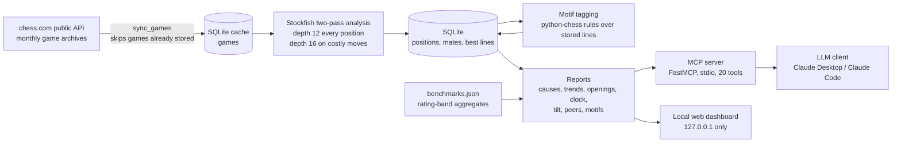

# chess-coach

[](https://github.com/m-allakov/chess-coach/actions/workflows/tests.yml)

**Why am I not winning more of my chess.com games, and what should I practise this week?**

chess-coach downloads a player's chess.com games, checks every move with Stockfish, and serves
the results as [MCP](https://modelcontextprotocol.io) tools. An LLM client such as Claude can then
answer that question from the player's own games, with sample sizes attached. The numbers come
from code; the model only puts them into words.

**Two-pass analysis (depth 12, re-checked at depth 16 on costly moves) recovers ~94% of the
blunders a depth-20 search finds.** A flat depth-20 search took 90 s per blitz game in the depth
benchmark. The two-pass analysis takes a median of 10.4 s per game in production. Those two
timings come from different games and engine settings, so no ratio is given
([evidence](docs/evidence)).

## Example

> *"Why am I not winning my blitz games?"* → the client calls `coach_plan(username, time_class="blitz")`

Real output from the author's last 100 blitz games, trimmed (game links removed):

```json
{
  "games_not_won": 59,
  "why_games_were_not_won": {
    "thrown_win": {"games": 33, "share_of_non_wins": 0.56, "meaning": "had a winning position and did not win"},
    "blunder":    {"games": 12, "share_of_non_wins": 0.2,  "meaning": "one costly mistake decided it"},
    "time":       {"games": 8,  "share_of_non_wins": 0.14, "meaning": "lost on the clock while the position was not clearly lost"},
    "opening":    {"games": 6,  "share_of_non_wins": 0.1,  "meaning": "was already clearly worse after the opening"}
  },
  "weekly_focus": {
    "area": "thrown_win",
    "because": "33 of 59 recent games that were not won (had a winning position and did not win)."
  },
  "trend_vs_earlier_games": {
    "score_pct": {"recent": 42.0, "before": 52.2, "change": -10.2, "noise_margin": 10.1, "verdict": "worse"}
  },
  "commentary": {
    "backend": "template",
    "text": "33 of your 59 recent games that were not won started from a winning position. Across 414 such games in your history, the opponent's very next move won material or mated after 45% of your decisive blunders, and in 92% you still had plenty of time: the pattern points at a checking habit rather than at speed. ...",
    "faithfulness": {"ok": true, "unsupported_numbers": []}
  }
}
```

## What it does

- **Why am I losing?** Assigns each game that was not won one main cause (thrown win, single
  blunder, bad opening, clock, gradual decline), picks one focus for the week, and compares
  recent games with earlier ones. A change is only called real when it is larger than the noise margin.
- **Which mistakes do I repeat?** Grades every move by how much win chance it lost. Mistakes and
  blunders get a tag for what went wrong (piece left hanging, missed capture/check/mate, allowed
  fork, pin or discovered attack, ignored threat). It also lists the costliest moments and the wins
  the player let slip.
- **Where and when do I play badly?** Breaks results down by opening, game phase, clock pressure,
  time of day, and play after a loss (tilt). It also measures how often the player saves bad positions.
- **How do I compare with players at my level?** Puts the player's 3+0 blitz numbers next to
  rating-band medians and quartiles measured on public games.
- **Show me the game.** Returns any cached game move by move with evaluations, best lines, clock
  times and tags. A local web dashboard adds a board viewer and exercises built from the
  player's own mistakes.

## Architecture



### Knowledge layer

`coach_plan` attaches short practice advice to the weekly focus. On the author's machine that
advice comes from principles written from chess-training books. **That full set is kept private for
copyright reasons.** This repository ships the code, the schema, a bibliography (titles and
authors) and five [example principles](examples/knowledge). The examples are written in original
wording and are marked as drafts. When the private set is absent, the code loads the examples.

## Key engineering decisions

**1. Two-pass engine analysis instead of a flat deep search.**
- *Decision:* search every position at depth 12, then search again at depth 16 only for the two
  positions around any move that lost 80 cp or more at depth 12 ([analysis.py](src/chess_coach/analysis.py)).
- *Alternatives:* flat depth 20 (the reference), or a flat depth of 14 to 18.
- *Why:* a flat depth 20 took 90 s per blitz game on one 4-thread engine. Depth 12 took
  2.1 s but found only 83% of the depth-20 blunders.
- *Evidence:* on 12 games / 865 positions,
  [docs/evidence/depth_benchmark.txt](docs/evidence/depth_benchmark.txt) measured blunder recall
  and seconds per game for depths 6 to 20. Compared with a depth-20 search of the same moves, the
  two-pass result recovered 94.2% of blunders at 90.3% precision (940 moves, about 800 rating)
  ([two_pass_validation_800.txt](docs/evidence/two_pass_validation_800.txt)). On stronger players
  it recovered 94.4% at 94.4% precision (721 moves, 1500 to 2300 rating)
  ([two_pass_validation_1500-2300.txt](docs/evidence/two_pass_validation_1500-2300.txt)).
- *Not tuned yet:* the 80 cp cut-off and the depth-16 second pass were chosen by judgement, not
  by a parameter sweep ([tuning issue](https://github.com/m-allakov/chess-coach/issues?q=is%3Aissue+%22Justify+the+two-pass%22)).

**2. Grade moves by lost win chance, not raw centipawns.**
- *Decision:* convert evaluations to win chance with Lichess' published logistic fit. Lost
  win-chance points set the grade: inaccuracy 5, mistake 10, blunder 15
  ([classify.py](src/chess_coach/classify.py)).
- *Alternative:* fixed centipawn cut-offs (100/200 cp).
- *Why:* losing 200 cp from an equal position decides a game. Losing 200 cp when already up
  +900 changes nothing.
- *Evidence:* the rationale is written in `classify.py`.
- *Not tuned yet:* the 5/10/15 win-chance thresholds were chosen by judgement and have not been
  tested against any reference (same [tuning issue](https://github.com/m-allakov/chess-coach/issues?q=is%3Aissue+%22Justify+the+two-pass%22)).

**3. Facts come from code, words from a replaceable commentator, and the text is checked.**
- *Decision:* reports return structured facts. Prose comes from a `Commentator` interface. Every
  number in the generated text is checked against the facts, and unfaithful text is replaced by
  the template output ([commentary.py](src/chess_coach/commentary.py)).
- *Alternative:* let the LLM read raw evaluations and write the coaching itself.
- *Why:* a coaching claim is only useful if it is true of the player's games.
- *Evidence:* tests in `tests/test_commentary.py`.
- *Not done yet:* only the template backend exists, so no LLM backend has been through this check.

**4. Peer comparison from public games, aggregates only, same clock.**
- *Decision:* [scripts/find_peers.py](scripts/find_peers.py) samples active public players
  (country lists TR/IS/LT, plus CM/NM title lists for the top band, rating deviation ≤ 90,
  played blitz in the last 45 days) into four blitz bands.
  [scripts/build_benchmarks.py](scripts/build_benchmarks.py) runs them through the same analysis
  pipeline and writes only band medians and quartiles to
  [benchmarks.json](src/chess_coach/benchmarks.json). No usernames or games are kept in the file.
- *Alternative:* compare against chess.com's published averages (no per-metric data), or keep
  per-player rows.
- *Why:* a fair comparison needs the same metric code on the same time control (3+0 only), and
  publishing other players' data is not acceptable.
- *Evidence:* 14 to 17 players per band, 30 games each. A band built from fewer than 8 players is
  marked tentative and the tool gives no verdict for it ([peers.py](src/chess_coach/peers.py)).

**5. Every comparison carries its noise margin.**
- *Decision:* rates are compared with a 95% noise margin, and rates built from moves use
  per-game values. Moves inside one game are not independent, so the honest sample size is the
  number of games ([stats.py](src/chess_coach/stats.py)). Each side needs at least 10
  observations before a difference can be called clear.
- *Alternative:* report raw differences.
- *Why:* with tens of games per window, a 10-point swing in score can be luck. In the example
  above the swing is −10.2 against a margin of 10.1.

## Numbers

All numbers come from the author's local database or from the files in [docs/evidence](docs/evidence).

| | |
|---|---|
| Games cached | 3,104 (Dec 2025 – Oct 2026; blitz 1,265, bullet 1,075, rapid 762, daily 2) |
| Games analysed | 2,800 (90.2%); 304 pending |
| Positions stored | 165,765 |
| Costly moves tagged with a motif | 12,677 in 2,799 games; 57.6% match no rule (`untagged`) |
| Engine time per game, two-pass (production) | median 10.4 s, mean 13.7 s over 2,800 games (Stockfish 19, 2 threads/engine, up to 4 engines in parallel) |
| Engine time per game, flat depth (benchmark, 1 engine, 4 threads) | depth 12: 2.1 s · 14: 9.8 s · 16: 27.3 s · 18: 48.0 s · 20: 90.0 s |
| Quickstart sample (fresh clone, 16 logical CPUs) | 30 games analysed in 132 s wall clock |
| Peer benchmark | 4 rating bands, 14–17 players each, 30 games of 3+0 blitz per player |
| Tests | 197 passed, 4 skipped as cloned (the skipped ones need the private principle set); 201 passed with it |

All timings were measured on a Ryzen 9 7940HS.

## Quickstart

Requires Python 3.11+ and a [Stockfish](https://stockfishchess.org/download/) binary. Stockfish
is GPL-licensed and is not included in this repository.

```bash
git clone https://github.com/m-allakov/chess-coach.git
cd chess-coach
python -m venv .venv
source .venv/bin/activate          # Windows: .venv\Scripts\activate
pip install -e ".[dev]"
pytest -q
```

Point the code at a database and at Stockfish. The variables are listed in
[.env.example](.env.example). The code reads them from the environment and does not load the
file itself.

```bash
export CHESS_COACH_DB=./.data/games.db
export CHESS_COACH_STOCKFISH=/path/to/stockfish
```

**Try it offline with the sample** (30 anonymized 3+0 blitz games, player `sample_player`):

```bash
python examples/load_sample.py
python -m chess_coach.cli analyze sample_player
python -m chess_coach.cli tag sample_player
```

**Or use your own games** (chess.com public API, no account or key needed):

```bash
python -m chess_coach.cli sync <your_chess_com_username> --months 3
python -m chess_coach.cli analyze <your_chess_com_username>
python -m chess_coach.cli tag <your_chess_com_username>
```

**Connect an MCP client.** For example, in Claude Desktop's `claude_desktop_config.json` or in a
project `.mcp.json` for Claude Code:

```json
{
  "mcpServers": {
    "chess-coach": {
      "command": "/absolute/path/to/chess-coach/.venv/bin/chess-coach-mcp",
      "env": {
        "CHESS_COACH_DB": "/absolute/path/to/chess-coach/.data/games.db",
        "CHESS_COACH_STOCKFISH": "/path/to/stockfish"
      }
    }
  }
}
```

Then ask: *"Use coach_plan for sample_player. Why are the games not being won?"*

**Optional dashboard:** `chess-coach-web --username sample_player`, then open http://127.0.0.1:8765.

## MCP tool reference

<details>
<summary>20 tools, grouped by the question they answer</summary>

| Question | Tool | What it returns |
|---|---|---|
| Get my data in | `sync_games` | Downloads the last N monthly archives (standard chess only) and skips games already stored |
| | `analyze_games` | Two-pass Stockfish analysis of pending games, newest first, in time-boxed batches; also tags motifs |
| | `tag_motifs` | Tags mistakes and blunders with the kind of error |
| | `backfill_game_details` | Adds mate scores and best lines to games analysed before those were stored |
| | `analysis_status` | Games cached / analysed / pending |
| Why am I not winning? | `coach_plan` | **Start here.** One cause per game not won, a weekly focus with evidence, sourced advice, a trend with noise margin |
| | `weakness_report` | Losses by phase, colour and time control; winning positions thrown away |
| | `conversion_report` | Games that reached a winning position and were not won: the move where it collapsed, its clock, its tags |
| Which mistakes do I repeat? | `motif_report` | Count, share and average win-chance loss per motif, split by phase, pace and colour, with examples |
| | `worst_moments` | Costliest confirmed blunders with FEN, move played, best move |
| | `missed_opportunities` | How often the player punished opponent blunders; missed forced mates |
| | `sacrifice_candidates` | Sound piece offers (a rough stand-in for chess.com's "brilliant"; see Limitations) |
| Where and when do I play badly? | `opening_report` | Results and opening-phase quality per opening and colour |
| | `time_pressure_report` | Errors by clock zone, hasty vs considered blunders, losses on time |
| | `tilt_report` | Play after losses and late in a session |
| | `time_of_day_report` | Results and blunder rate by hour and weekday/weekend |
| | `resilience_report` | How often clearly worse positions were saved |
| How do I compare? | `peer_comparison` | 3+0 blitz metrics next to four rating bands (p25 / median / p75) |
| Show me a game | `list_games` | Cached games with filters, to find a `game_id` |
| | `get_game` | One game move by move: evals, win chances, grade, best line, clock, motifs |

</details>

## Limitations and roadmap

- **No one has checked whether the coaching advice is correct.** The faithfulness check confirms
  that numbers in the text match the computed facts. It does not test whether the advice is right
  for the player. Next: an LLM-based evaluation of coaching output against engine ground truth.
- **Local only.** The MCP server runs over stdio and the dashboard listens on 127.0.0.1. A web
  deployment is planned.
- **Motif rules explain a minority of costly moves.** 57.6% of tagged moves match no rule.
- **"Brilliant" detection did not work.** A rule tested against chess.com's own labels found 38 of
  39 brilliant moves at 9.4% precision ([brilliant_onlymove.txt](docs/evidence/brilliant_onlymove.txt)).
  `sacrifice_candidates` therefore says it over-reports.
- **Small peer samples.** 14 to 17 players per band, drawn from three countries and two title
  lists, 3+0 blitz only.
- **Sync downloads the last N months again on every run.** Duplicates are skipped by game URL. It
  makes no conditional requests and has no retry or back-off for rate limits.
- The trend compares recent games against all earlier games, including much older and lower-rated
  ones. No opening-book detection exists.
- Only the template commentary backend exists. The coach agent described in
  [docs/PROJECT_PLAN.md](docs/PROJECT_PLAN.md) is not built.

## How it was built

Built with AI-assisted development (Claude Code). I owned problem framing, architecture, analysis
decisions and verification.

## License

MIT, see [LICENSE](LICENSE). Stockfish is not distributed with this project.
